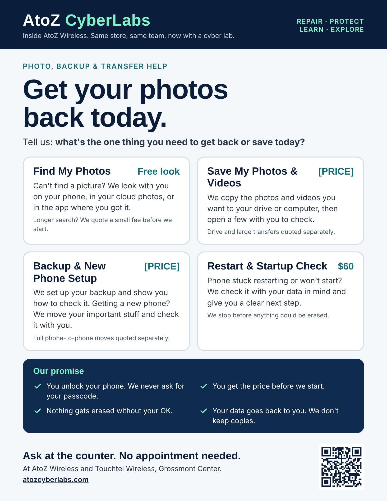

# DS-005: Photo, Backup & Transfer Help (Counter Services)

**AtoZ CyberLabs | Data Service 005 | CyberBench counter workflow**

| Document ID | Version | Applies to | Owner | Last reviewed |
|---|---|---|---|---|
| DS-005 | 0.1 (draft) | iPhone and Android, both stores | AJ | 2026-11-24 |

**Policy:** [POL-001](../policies/POL-001-data-services.md)

**Objective:** A customer walks in with a specific problem, gets a clear price at the counter, and leaves knowing what was saved and where to find it.

**Use this when:** a customer asks about missing photos, saving their pictures, or whether their phone is backed up.

> **Golden rule:** **quote before you start.** The customer agrees to the price, the pickup time, and what happens if nothing is found, before any paid work begins.

---

## The three counter services

| The customer says... | We offer | What we do |
|---|---|---|
| "I can't find my pictures." | **Find My Photos** | Look with the customer on the unlocked phone, in their cloud photo library, or in the app where they received the pictures. |
| "Can you save these before I replace my phone?" | **Photo & Video Copy** | Export the files they want to their drive or computer, then open a few together to confirm the copy works. |
| "Is my stuff backed up?" | **Backup Setup & Check** | Help them set up a backup, and show them how to check when it last finished and where their photos are stored. |

Customer-facing name for all three: **Photo, Backup & Transfer Help.**

### Counter flyer

This is what customers see at the counter. Know what it promises, because every promise on it is a rule we follow.



> **Draft:** the [PRICE] spots get filled in by AJ before printing. Prices live in RepairDesk.

---

## Step 1: Counter check (2 minutes, free)

Before quoting, check two things with the customer:

1. **Can they unlock the phone?** The customer enters the passcode.
2. **Is there an obvious place to look?** Recently Deleted, Hidden, Shared Library, their cloud photos, or the app or message where they got the pictures.

| Result | Next step |
|---|---|
| **Unlocks, and there's a clear place to look** | Go to Step 2 and quote. |
| **Can't unlock** | Not a counter service. Explain why, and offer [DS-001](DS-001-software-rescue.md) or a repair diagnosis if the phone is stuck or broken. |
| **The photos turn up during the check** | Show the customer. No charge. Offer Backup Setup & Check so it doesn't happen again. |

## Step 2: Quote up front

| Job | How to quote |
|---|---|
| Short search (Find My Photos) | Flat fee |
| Backup Setup & Check | Flat fee |
| Small photo or video copy | Flat fee, plus the drive if they need one |
| Large copy or full migration | Quote separately. Full migrations follow [DS-004](DS-004-new-phone-migration.md). |

Prices come from RepairDesk, not from this toolbox.

**Before you start, tell the customer three things and note them in the ticket:**

1. **The price**
2. **The pickup time.** A big transfer can take longer than the hands-on time, so give a realistic time, not just how long you'll spend on it.
3. **What happens if nothing is found.** Agree on this before a paid search starts. [AJ: set the rule, e.g. reduced fee or no charge.]

## Step 3: Do the work

| Service | How |
|---|---|
| **Find My Photos** | Search with the customer next to you. Check Recently Deleted, Hidden, Shared Library, the cloud photo library, and the original message or app. Look only at what you need to find the item. |
| **Photo & Video Copy** | Connect to the store computer or the customer's computer. The customer taps **Trust** and enters the passcode. Copy only the items they ask for, straight to **their** drive or computer. Never keep a copy on the store computer. |
| **Backup Setup & Check** | Follow Part 2 of [DS-003](DS-003-backup-before-repair.md). Show them both places: when the last backup finished, and whether their photos are in cloud photos. These are separate. |

## Step 4: Handoff

Before the customer leaves:

1. **Show what was saved.** Open a few files together from the drive, or show the backup date.
2. **Tell them where it is.** One line, like: "Your photos are on this drive, in the folder named with today's date," or "Your phone last backed up today at 2:14."
3. **Fill in the tracking log** (below).
4. Tag the ticket `DS-FIND`, `DS-COPY`, or `DS-BACKUP`.

---

## Two-week trial: tracking log

For the first two weeks, **both stores** use these three workflows the same way, and log every counter request, including the ones that don't buy.

Use the [counter trial log](../templates/counter-trial-log.md). It records:

- What the customer asked for
- Whether they accepted the quote
- Hands-on minutes
- What we handed back

At the end of the two weeks, AJ reviews the log. If customers often need single files pulled from an older backup, that's the job to test with a backup-browsing tool, on a shop phone first, before buying more software. See [POL-001 section 3.5](../policies/POL-001-data-services.md#35-approved-tools).

---

## Stop and contact AJ

Stop and message AJ on Discord if:

- The customer can't prove the phone or account is theirs
- Someone asks you to look at another person's phone or account
- A copy keeps failing, or the phone shuts off during it
- The customer disputes the "nothing found" rule after the search

No customer details in Discord.

---

## Findings record

```
DS-005 Findings
Service:              Find My Photos / Photo & Video Copy / Backup Setup & Check
Customer asked for:
Unlocked by customer: Yes / No
Quote given:          Yes   Accepted: Yes / No
Pickup time given:
"Nothing found" rule agreed: Yes / Not needed
Hands-on minutes:
Handed back:
Customer shown where it is: Yes / No
Technician / Store / Date:
```

## Revision history

| Version | Date | Change | By |
|---|---|---|---|
| 0.1 | 2026-11-24 | First draft | AJ |
