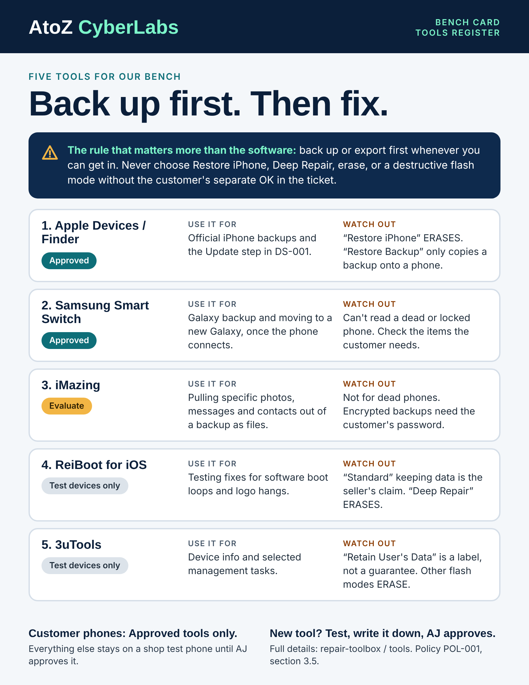

# Bench Tools Register

**AtoZ CyberLabs | Approved and evaluated software**

| Document | Version | Owner | Policy | Last reviewed |
|---|---|---|---|---|
| Tools register | 0.1 (draft) | AJ | [POL-001 section 3.5](../policies/POL-001-data-services.md#35-approved-tools) | 2026-11-24 |

Only tools marked **Approved** may be used on a customer's device. Everything else is tested on a **shop-owned test phone** first, and AJ approves it before any customer job.

> **The rule that matters more than the software:** back up or export first whenever you can get into the phone. Never choose **Restore iPhone**, **Deep Repair**, **erase**, or a **destructive flash mode** without the customer's separate approval in the ticket.

Listing a tool here is not an endorsement. It only records what our bench may use and how.

---

## Status key

| Status | What it means |
|---|---|
| **Approved** | Techs may use it on customer devices, for the uses listed |
| **Evaluate** | AJ is testing it on shop phones. Not for customer devices yet. |
| **Test devices only** | Allowed on shop phones for learning and testing. Never on a customer's phone. |

---

## Data and recovery tools

| # | Tool | Main purpose | Where it fits | Important limitation | Status |
|---|---|---|---|---|---|
| 1 | [Apple Devices](https://support.apple.com/118290) (Windows) / Finder (Mac) | Apple's own app for backups, software updates, and restores | Our baseline iPhone tool. Local backups and the Update step in [DS-001](../data-services/DS-001-software-rescue.md). Use it before buying anything that does the same job. | **"Restore iPhone" erases the phone.** Don't confuse it with **"Restore Backup,"** which copies a backup onto a phone. | **Approved** |
| 2 | [Samsung Smart Switch](https://www.samsung.com/global/galaxy/apps/smart-switch/) | Galaxy backup, restore, and moving to a new Galaxy | Our baseline Samsung tool, once the phone works well enough to connect and the customer allows it | It can't read a phone that's dead or locked. Don't assume a backup has every app's data. Check the items the customer needs. | **Approved** |
| 3 | [iMazing](https://imazing.com/) | Browse iPhone backups and export photos, messages, contacts, and notes as files you can open | First paid tool to evaluate. For pulling specific items from a backup, or saving data once we can get into the phone. | Not a dead-phone recovery tool. Encrypted backups need the customer's backup password. | **Evaluate** |
| 4 | [Tenorshare ReiBoot for iOS](https://www.tenorshare.com/products/reiboot.html) | Tries to fix software boot loops, Apple logo hangs, and recovery mode problems | A controlled test tool for suspected iOS faults. Not an automatic next step for every restarting phone. | "Standard Repair" is advertised as keeping data, but that's the seller's claim, not a guarantee. **"Deep Repair" erases data.** | **Test devices only** |
| 5 | [3uTools](https://www.3u.com/) | iOS device info, backup, data management, and firmware flashing | A supplementary tech utility for device info and selected tasks. Not our main customer data tool. | Flash modes have very different results. "Retain User's Data" is the seller's label, not a guarantee. **Other modes erase data.** | **Test devices only** |

## Diagnostic tools

These are already approved in [DP-001](../iphone/diagnostics/random-restarts/tools.md).

| Tool | Main purpose | Status |
|---|---|---|
| iPanic Extractor | Pulls the latest panic-full log off an unlocked iPhone. Doesn't change, unlock, or restore the phone. | **Approved** |
| iDevice Log Analyzer | Matches a panic log against known issues | **Approved** |

---

## What we start with

For saving photos and files from broken phones:

1. **Apple Devices / Finder** for every official Apple backup and update
2. **Smart Switch** for every Samsung backup and move
3. **iMazing** as the one paid tool to evaluate, for exporting specific items as files

ReiBoot and 3uTools stay on shop test phones until AJ approves their use, especially any feature that writes firmware to a phone.

## How a tool gets approved

1. **Check the license first.** Confirm the tool allows commercial repair shop use, how many devices it covers, and how renewal works. Start with **one** paid tool, not five subscriptions.
2. **Test it on a shop-owned phone,** never a customer's.
3. **Write down what it actually did:** which file types it exported, whether data survived, and how long it took.
4. **AJ approves it,** and it's added here with its allowed uses.
5. **Measure it.** After a month, check whether it helped the team deliver the files customers asked for. If not, drop it.

## Revision history

| Version | Date | Change | By |
|---|---|---|---|
| 0.1 | 2026-11-24 | First draft | AJ |
